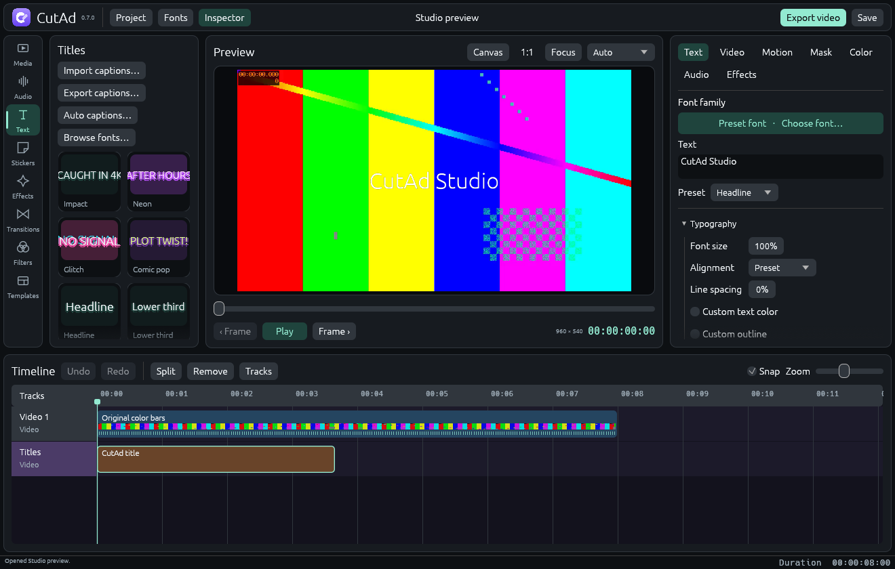

# CutAd

[](https://github.com/ArthurSimin/CutAd/actions/workflows/build.yml) · [Download CutAd](https://github.com/ArthurSimin/CutAd/releases/latest) · [Connect an AI client](docs/MCP.md)

CutAd is an offline desktop video editor written in Rust for Linux and Windows. Editing and export run locally, without ads, promotions, accounts, or watermarks.



## Get CutAd

Download the Windows x86-64 ZIP or Linux x86-64 tarball from [Releases](https://github.com/ArthurSimin/CutAd/releases). Extract the archive and run the included executable. Install FFmpeg 8 or later for media preview and export. Releases include dependency notices and SHA-256 checksums.

## Use CutAd with an AI client

Run `cutad --mcp-config codex "/absolute/path/My edit.cutad"` to generate a ready-to-paste entry. The [MCP setup guide](docs/MCP.md) also covers Claude Code, OpenCode, Kilo Code, and Antigravity. Use read-only mode to inspect a timeline or opt in to editing and export.

## Run from source

Install Rust 1.95 or later and FFmpeg 8.0 or later. Put `ffmpeg` and `ffprobe` on PATH or beside the executable. Choose a build with libx264, libvpx, libopus, libmp3lame, FFV1, FLAC, and the drawtext filter. On Linux, the app uses OpenGL, ALSA, and X11 or Wayland. Source builds need the ALSA development package. File selection uses an XDG Desktop Portal backend or the Zenity fallback.

```sh
cargo run --locked --release
cargo build --locked --release
cargo test --locked --release
```

The release executable is `target/release/cutad` on Linux and `target/release/cutad.exe` on Windows. [FFmpeg downloads](https://ffmpeg.org/download.html)

GitHub builds Linux releases on Ubuntu 24.04. Build from source if your distribution needs a different ABI. The Windows x86-64 build uses the same Rust source. Extract the new archive to its own folder and run its `cutad.exe`. The current version is shown beside the CutAd logo.

The GitHub Actions workflow can also run the background removal and reframe tests on both platforms. Enable **Run the local background removal and reframe tests** when starting the workflow manually.

## Edit a video

1. Import videos, audio files or still images into the left dock. Drag a media tile onto the timeline, drag a clip to move it, or drag either end to trim.
2. Click the ruler to position the playhead. Right-click clips to split, trim to the playhead, duplicate, replace media, detach audio, or remove the clip. **Ripple delete** closes the removed span on that track.
   **Copy clip settings** and **Paste clip settings** transfer compatible visual and audio settings while keeping the destination clip’s media and timing.
   **Insert freeze frame** holds the source frame for three seconds and moves the remaining clips on that track forward. **Reverse clip…** saves a separate Matroska file that plays the selected source span backward and places it onto the existing timeline clip. Keep the generated file with the project. **Split at scene changes** scans the selected source range for hard cuts. Use **Video → Crop and mirror** to crop by edge or flip a video or image.
   Use **Markers** to name a playhead position and jump back to it. Markers stay at their timeline positions and act as snap points.
   **Generate optical flow…** creates a 120 fps copy with motion-compensated in-between frames. **Stabilize clip…** reduces camera shake. Both work on supported opaque 8-bit footage and save a separate media file.
3. Select a clip to open the right inspector. Adjust scale, position, rotation, opacity, and timing under **Video**, or gain and fades under **Audio**. The timeline displays waveforms for audible source clips. **Mask** supports rectangle, ellipse, and linear masks with position, rotation, feathering, and inversion. Use **Color** for brightness, contrast, saturation, and chroma key. Put the background you want to reveal on a lower video track. Add editable text under **Text** in the left dock. Choose a preset under **Effects** or **Filters**, and use **Apply stack** to update its strength, order, or enabled state.
4. For a transition, select the incoming clip at a cut on the same video track. Transitions use the last outgoing frame and the incoming clip. Their duration fits inside the incoming clip and leaves edit timing intact.
5. Scrub the ruler to preview the current frame automatically. **Auto** uses a responsive draft while scrubbing or playing and shows full canvas resolution when paused. Select **Full canvas** to play at canvas resolution, or **Half resolution** and **Quarter resolution** to reduce decoder and display work. Use **1:1** to inspect native pixels and **Focus** or **F** to expand the player. **Project** has a **Reduce interface motion** option.
6. New projects follow the first video’s dimensions within the 4096-pixel canvas limit. For an existing edit, choose **Canvas → Match first video**. Export uses the canvas dimensions by default. Choose **MKV · Lossless** for FFV1 video with 4:4:4 chroma and FLAC audio, or **MP4** for wider playback compatibility. The compositing pipeline works in 8-bit SDR with a 48 kHz stereo mix. Video export supports 24, 30, 60, and 120 fps. Supported high frame rates are rendered from source frames before encoding.
7. Save a `.cutad` project. Media inside the project folder is stored with relative paths. Keep that folder together when moving projects.

For large 8-bit SDR videos, right-click a timeline clip and choose **Create preview proxy…**. CutAd saves a smaller video for reduced-resolution previews. Full-canvas preview, audio playback, and export read the original media. **Unlink preview proxy** removes the association without deleting the file.

Use **Project → Save portable copy…** to collect source media and LUTs into a new folder with relative paths. Open `Project.cutad` inside that folder. Install any custom fonts used by the project on the destination computer.

See the [CapCut workflow inventory](CAPCUT_WORKFLOWS.md) and [setup evidence](SETUP_EVIDENCE.md) for the public feature reference and installer inspection.

In **Export video**, choose the entire edit, the selected clip’s timeline span, or custom In and Out times. Range export includes every track in that span.

Choose **Animated GIF** in the same dialog for a continuously looping animation. GIF export defaults to 15 fps and a 480-pixel short edge.

Select a video or audio clip and use **Video → Playback speed** to choose a constant rate from 0.25× to 4×. Changing speed keeps the clip’s source selection and moves later clips on that track to preserve gaps. Audio keeps its pitch by default. For a separate pitch change, use **Audio → Pitch**.

Use **Video → Blend** to merge a visual clip with the layers beneath it. The **Animation** inspector provides independent keyframes and easing for position, opacity, rotation, and scale.
Open **Project → Open recent** to return to saved edits. CutAd backs up unsaved changes in a separate local draft. If the app exits unexpectedly, choose the recovered draft at startup or use **Project → Recover autosaved draft…**. Save the recovered edit to a project file when you are ready.

Hold **Ctrl** while clicking timeline clips to select several, then press **Ctrl+G** or choose **Tracks → Group selected clips**. Drag a member to move the group. Right-click a member and choose **Ungroup** to move clips separately again.

To align camera footage or an external recording, select two to nine clips on separate tracks. Select the reference clip last, then choose **Tracks → Sync selected clips by audio**. CutAd searches the first 45 seconds of each selection for matching sound, with at least three seconds of overlap and a maximum offset of 30 seconds. Source trims stay in place.

For silent footage or a visible clap, place the playhead on the cue in each clip and choose **Set sync point at playhead** from its clip menu. Select the clips with the reference last and choose **Tracks → Sync selected clips by points**.

With the aligned video clips still selected, choose **Tracks → Edit camera angles…**. Scrub to the cut and click an angle preview. **Apply angle cuts** creates editable timeline clips and keeps the source angles on muted tracks. By default the selected reference angle supplies continuous audio when it has an audio stream. If an angle ends before the next cut, the edit returns to the reference angle.

For narration, click **Voiceover…** above the timeline, choose a microphone, and select where to save the WAV. You can play the current edit while recording. **Stop and keep** adds the take at the original playhead position on an available audio track. **Discard** drops the take before it is saved.

Select a music clip and choose **Audio → Detect beats** to add timeline markers at recurring pulses. Existing markers keep their names, and snapping can align edits to the new markers. Move the playhead inside an audio clip to add **Gain keyframes** with editable levels and easing. The gain curve applies in preview, exports, and audio-only renders.

To follow a moving subject, place an overlay above the footage, select it, and open **Animation → Motion tracking**. Use **Go to first frame** and position the tracking patch over a textured feature. **Track position** creates editable X/Y keyframes. The tracker follows translation and works best when the feature stays visible and changes shape little.

In the **Color** inspector, **Auto color** samples the selected clip at the playhead. **Match tone…** uses the first frame of a local reference image or video. Both set editable brightness, contrast, and saturation controls, and Undo restores the previous grade.

In the export dialog, **Title and cover** lets you write a title into MP4, WebM, or Matroska files. MP4 can also embed a timeline frame as its cover.

### Automatic background removal and reframing

Install [rembg](https://github.com/danielgatis/rembg) with its CPU dependencies in a Python 3.12 environment using `python -m pip install "rembg[cpu]==2.0.69"`. Set `CUTAD_CUTOUT_PYTHON` to that interpreter before launching CutAd if the environment is outside your normal PATH. Obtain compatible [U²-Net or U²-Net Lite ONNX weights](https://github.com/danielgatis/rembg/releases/tag/v0.0.0) and keep them on disk.

Select a video or image and open **Mask → Remove background…**. The same command is in the timeline clip menu. Choose the local model and save the cutout. Run it offline once dependencies and weights are installed. CutAd switches the selected clip to a transparent PNG or an 8-bit SDR lossless Matroska file with audio. Its timeline placement and edit settings carry forward, and Undo restores the original source. Put another clip underneath to see it through the transparent areas. Video runs the model on each frame, so processing time and edge consistency depend on the footage, model, and CPU.

To refine a clip by hand, pause inside the clip and select **Mask → Erase brush** or **Restore brush**. Paint in Preview. The same mask applies across the clip and follows its transform. Restore recovers pixels hidden by the clip mask when those pixels exist in the source. Every stroke can be undone.

For **Auto reframe…**, set the project’s canvas ratio, select a clip, and open **Animation**. Choose the same local model. CutAd samples the clip, scales it to fill the canvas, and writes editable position keyframes that follow the detected foreground. This replaces the clip’s existing scale and position animation in one undoable edit. Reset rotation and crop before applying it.

Use **Audio → Channels** to keep the stereo mix, mix it to mono, or route one source channel to both sides. **Balance** shifts the signal across the stereo output. **Normalize loudness** adjusts the selected clip toward −16 LUFS within the gain range and true-peak limit.

Use **Color → Choose color LUT** to grade a clip with a local 3D `.cube` file. Keep the LUT with the project when moving it to another computer.
**Hue, saturation, and intensity** adjusts selected color ranges before the LUT.

CutAd includes 42 presets across color, lens, motion, texture and audio, plus eight transitions. Choose **Effects → Motion → Motion blur** and adjust its strength to soften movement in the footage. Higher numbered video tracks are composited in front of lower numbered tracks. The timeline uses 30 ticks per second. Select a visual clip and open **Animation** to set **Fade in** and **Fade out** in seconds. **Fade both** applies up to half a second at each end. Fades render in preview and export and survive splits and trims. Add position keyframes by moving the playhead and editing X or Y, then choose how the clip moves between them. **Slide in from left** and **Slide in from right** create two editable position keyframes on a clip with no position animation.

## Import stickers and add text

- Move the playhead, open **Stickers**, and choose **Import sticker**. Pick a still image such as a transparent PNG or WebP, or an animated GIF. CutAd opens it on an editable overlay track.
- Select the overlay to adjust scale, position, rotation, opacity, and duration. The source image stays in its original location.
- Open **Text** for animated **Impact**, **Neon**, **Glitch**, and **Comic pop** styles. Selecting a title opens the **Text** inspector with the font family at the top. Wording, size, alignment, line spacing, fill, outline, and background update as you edit.
- Click the font family or open **Fonts** in the top bar. **Installed** lists system and CutAd fonts, with a sample for the selected face. **DaFont** lets you browse categories, filter the current page, or paste a direct DaFont font page URL. Review its license and choose **Install font**. **Open fonts** contains a curated catalog from Google Fonts.
- Use **Import font…** to add a local TTF, OTF, or ZIP. Downloads and imports are saved to the CutAd font library. Original DaFont archives are kept in the library’s `sources` folder so the author’s license and notices stay available. [DaFont FAQ](https://www.dafont.com/faq.php)
- Titles are transparent unless **Background box** is enabled. Choose **Text → Import captions…** to turn a UTF-8 SRT into editable caption clips at its original timecodes.
  Open **Text → Transcript** to search captions, jump to an editable caption, or export the transcript as plain text.
- Projects remember the selected family and face. Install the same font on another computer to preserve the appearance. CutAd falls back to a matching regular face or the preset font if it cannot find the selected one.

Select a title and choose **Generate narration** in the text inspector to save a WAV and place it at the title’s start. Install eSpeak NG and put `espeak-ng` on PATH or beside CutAd to use this command.

## Captions and separate exports

In the Text panel, **Translate speech to English** creates editable English captions from timeline audio. **Original and English captions** adds both tracks. These commands require whisper.cpp with a multilingual model.

- In **Text**, use **Export captions…** to save visible caption clips or just the selected track as SRT. Install [whisper.cpp](https://github.com/ggml-org/whisper.cpp) and put `whisper-cli` beside CutAd or on PATH to use **Auto captions…**. Choose a compatible local GGML model. Recognition uses the audible timeline mix offline. CutAd adds editable subtitle clips.
- In **Project**, choose **Export audio** for a 48 kHz stereo WAV, FLAC, or 320 kbps MP3. **Export current frame…** saves a full-canvas PNG of the playhead. Both use the timeline renderer.

## Templates and drafts

Select **Templates** to start from **Portrait montage**, **Widescreen opener**, **Side-by-side review**, or **Vertical reveal**. Replace each slot with your own media and edit the titles and transitions on the timeline. You can also save a reusable template or import a local, readable CapCut JSON draft. For media stored outside the draft directory, select **Import draft with media folder** or relink the footage after import.

The importer translates supported video, still-image, audio and plain-text tracks, timeline ranges, canvas size and volume. It reports unsupported settings and creates replaceable slots for missing media. The current test coverage uses generated draft fixtures. See the [desktop workflow coverage](FEATURES.md) for supported editing features, interoperability limits, and gaps.

Use the same renderer from a terminal for batch export:

```sh
cutad --import-draft draft_content.json project.cutad ./media
cutad --render project.cutad finished.mp4
cutad --render project.cutad master.mkv
cutad --export-audio project.cutad mix.wav
cutad --export-captions project.cutad captions.srt
cutad --export-frame project.cutad still.png 30
```

## License

CutAd source is MIT-licensed. The Rust dependencies retain the licenses declared in their own manifests. The bundled Ubuntu Light and DejaVu Sans Bold fonts retain their respective licenses. See [asset sources and notices](assets/README.md). FFmpeg runs as a separate program and carries its own license. [FFmpeg licensing](https://ffmpeg.org/legal.html)

## CI and releases

GitHub Actions builds and tests on Linux and Windows for main-branch pushes and pull requests. Pushing a version tag that matches `Cargo.toml` builds both archives and publishes a release after both test jobs pass. `scripts/package.py` assembles each archive from its release executable and installed Cargo dependencies.
